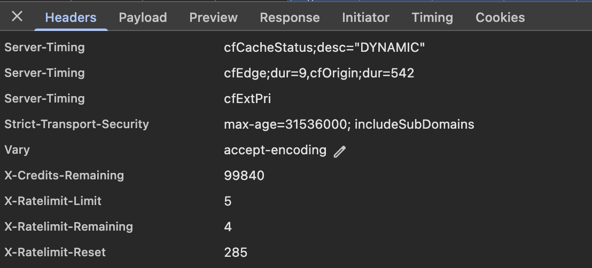
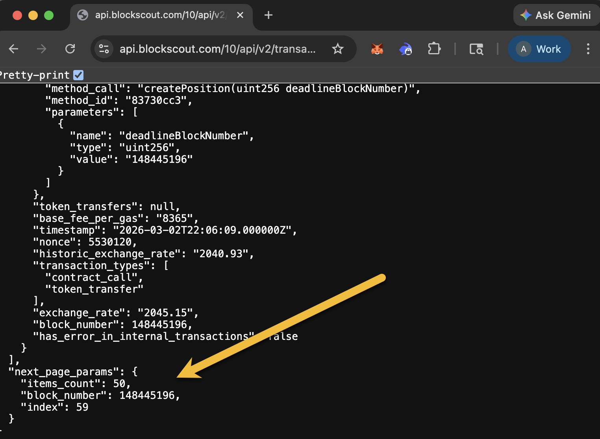
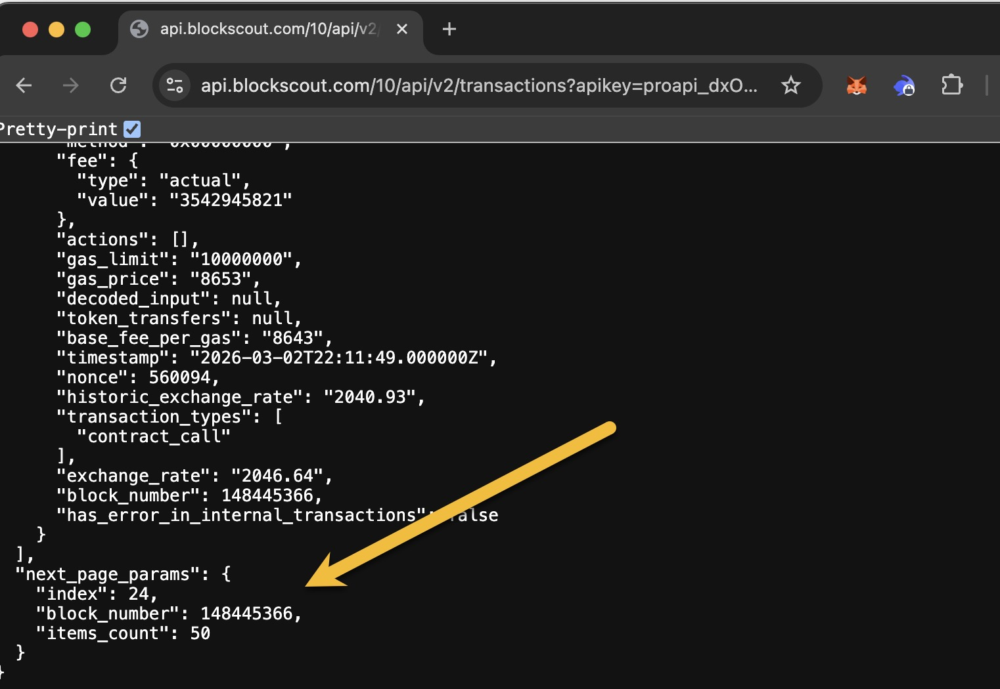

import CreditCosts from "/snippets/credit-costs.mdx";

<Check>
  Dev portal and free API key at [https://dev.blockscout.com/](https://dev.blockscout.com/)<br /><br />Agents visit [https://agents.blockscout.com/](https://agents.blockscout.com/) to access optimized instructions
</Check>

- [Authorization](#blockscout-api-authorization)
- [Routes](#blockscout-api-routes)
- [Pagination](#pagination)
- [Credits](#blockscout-credit-costs)

<Info>
  Blockscout API endpoints are documented individually in the API Reference menu.
</Info>

<Warning>
  Blockscout v12.0.0 was released on 7 October, 2026 and is rolling out to hosted instances in a gradual fashion. It includes breaking changes for API integrators. Please see the [v12.0.0 release page](/blockscout-v12-0-0-api-updates-and-breaking-changes) for details.
</Warning>

# Blockscout API Authorization

Pass an API key using either:

- `apikey` query parameter
- `authorization` header

## Blockscout API Response Headers

The following information related to the Blockscout API plan is included in the response headers:

- **x-credits-remaining:** Number of credits remaining in your plan. If on the free plan, this will reset daily, otherwise it is monthly. You can check additional details in the [Blockscout API UI](https://dev.blockscout.com/).
- **x-ratelimit-limit:** Available RPS with your plan (can be -1 if there is an internal error)
- **x-ratelimit-remaining:** Remaining rate limit based on your queries (can be -1 if there is an internal error)
- **x-ratelimit-reset:** time in milliseconds until the rate limit resets (can be -1 if there is an internal error)

<Frame>
  
</Frame>

# Blockscout API Routes

All current API routes can be used with the Pro Plan. See the Blockscout API Endpoints section to try example calls with your API key.

The Route examples below use the Optimism chain (chain_id=10). In previous per-instance routes API keys were optional for the free tier, but they are required for all tiers (including the free tier) of the Blockscout API.

## **JSON RPC API v2 (compare to Etherscan PRO API)**

Blockscout API Route:

```text wrap
https://api.blockscout.com/v2/api?chain_id=10&module=block&action=eth_block_number&apikey=proapi_xxxxxxxx
```

Previous per-instance route:

<Warning>
  `https://optimism.blockscout.com/api?module=block&action=eth_block_number`
</Warning>

## **JSON RPC API**

Blockscout API Route:

```text wrap
https://api.blockscout.com/10/api?module=account&action=eth_get_balance&address={addressHash}&apikey=proapi_xxxxxxx
```

Previous per-instance route:

<Warning>
  `https://optimism.blockscout.com/api?module=account&action=eth_get_balance&address={addressHash}`
</Warning>

## **REST API**

Blockscout API Route:

```text wrap
https://api.blockscout.com/10/api/v2/blocks/{block_number_or_hash}?apikey=proapi_xxxxxxxx
```

Previous per-instance route:

<Warning>
  `https://optimism.blockscout.com/api/v2/blocks/{block_number_or_hash}`
</Warning>

## **ETH RPC API**

See [ETH RPC docs](/devs/apis/rpc/eth-rpc) for more info on post requests.

Blockscout API Route:

```text
curl -H "content-type: application/json" \
  -H "authorization: Bearer proapi_xxxxxx" \
  -X POST \
  --data '{"id":0,"jsonrpc":"2.0","method":"eth_blockNumber","params":[]}' \
  https://api.blockscout.com/10/json-rpc
```

<Note>
  Please see the [API reference section](/devs/apis) for specific endpoint info related to the various API routes.
</Note>

# Pagination

Blockscout uses the keyset pagination method to quickly return results. By default an API response returns the first 50 results. To access additional results (in groups of 50), add the `next_page_params` to your query.

For example, open [**https://api.blockscout.com/10/api/v2/transactions?apikey=proapi_xxxxxx**](https://api.blockscout.com/10/api/v2/transactions?apikey=proapi_xxxxxx) and scroll to the bottom of the response.

<Frame caption="Example response from transactions query">
  
</Frame>

You will see the `next_page_params` object. Add the parameters from this object to your next query to receive the next 50 results.

[**https://api.blockscout.com/10/api/v2/transactions?apikey=proapi_xxxxxx&block_number=148445196&index=59&items_count=50**](https://api.blockscout.com/10/api/v2/transactions?apikey=proapi_xxxxxx&block_number=148445196&index=59&items_count=50)

Repeat this process to continue receiving results in groups of 50 (remove params and substitute the new `next_page_params` found in the body of the query).

<Frame>
  
</Frame>

In this example, the query to receive the next 50 results would be:

[**https://api.blockscout.com/10/api/v2/transactions?apikey=proapi_xxxxxx&block_number=148445366&index=24&items_count=50**](https://api.blockscout.com/10/api/v2/transactions?apikey=proapi_xxxxxx&block_number=148445366&index=24&items_count=50)

# Blockscout Credit Costs

Credit amounts vary based on resource usage for different calls. The number of credits required for different calls is subject to change based on current analytics and resource usage.

You can check your credits, top calls and overall usage in the dev portal dashboard at [https://dev.blockscout.com/](https://dev.blockscout.com/).

Credits are consumed per API call. The **default cost is 20 credits** for any endpoint not listed below.

- A request consumes credits once, no matter how many records the response contains. For example, a `txlist` call that returns 10,000 transactions costs the same as one that returns a single transaction.
- Etherscan-compatible RPC calls (`?module=...&action=...`, such as `txlist` and `tokentx`) are not listed in the table below, so they use the default cost of 20 credits per call.
- Some chains have a credit multiplier. On those chains, the endpoint's cost is multiplied by the chain's multiplier. See [Chain credit multipliers](/rate-limits#chain-credit-multipliers).
- Requests that return a `4xx` or `5xx` status cost no credits, with one exception: a `404` returned by the chain's Blockscout instance or service (for example, for a transaction that doesn't exist) is charged at the endpoint's normal cost. A `404` returned by the Blockscout API itself (`"source": "internal"`, such as an unsupported network or unknown path) is free. For x402 requests, every `4xx` and `5xx` is free, including `404`. See [x402 payments](/devs/x402-payments#no-charge-for-error-responses).

## When credits run out

- **Free plan:** the 100K credit allowance resets **daily**. Once it is exhausted, further requests are rejected until the daily reset. Requests are not automatically served at a lower rate limit. They fail instead.
- **Paid plans:** the monthly credit allowance may continue into overage once exhausted, subject to your plan terms.

Track remaining credits with the `x-credits-remaining` response header or the [developer portal dashboard](https://dev.blockscout.com/), and upgrade your plan if you regularly hit the cap.

<CreditCosts />
