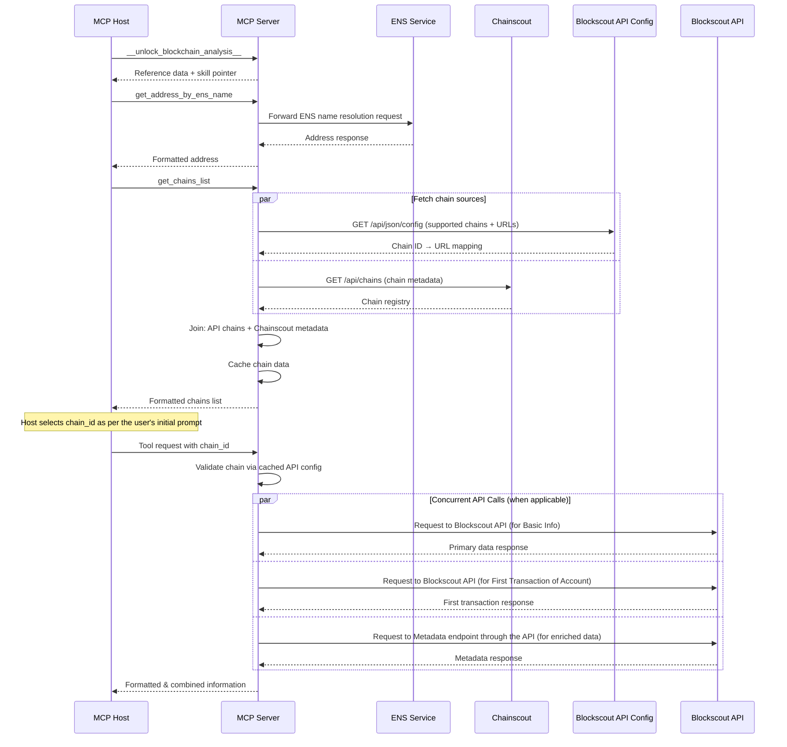
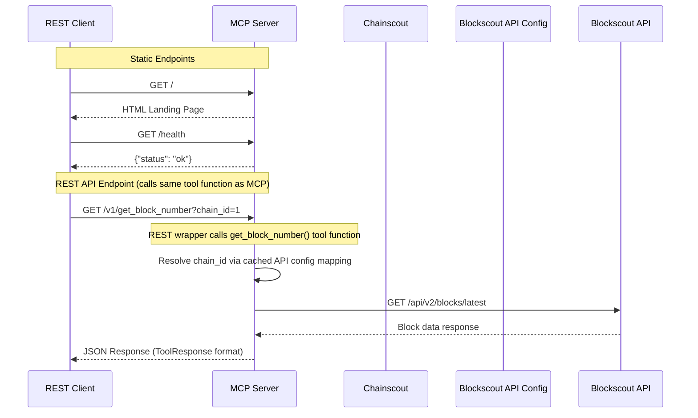

<Tip>
  - MCP Landing page: [https://mcp.blockscout.com](https://mcp.blockscout.com) - For setup instructions and additional details.
  - Github with technical specs and run information located at https://github.com/blockscout/mcp-server
</Tip>

The Model Context Protocol (MCP) is an open protocol designed to allow AI agents, IDEs, and automation tools to consume, query, and analyze structured data through context-aware APIs.

This server wraps Blockscout APIs and exposes blockchain data like balances, tokens, NFTs, contract metadata via MCP so that AI agents and tools (like Claude, Cursor, or IDEs) can access and analyze it contextually. Connect it to Claude, Claude Code, Codex, or Cursor and query chains in plain English, with answers that come straight from live Blockscout data.

<Tip>
  A single connection reaches every supported chain. Name the network in your prompt and the agent resolves its chain ID, or call `get_chains_list` to browse them all.
</Tip>

## Key Features

- Contextual blockchain data access for AI tools
- Multi-chain support across 100+ hosted EVM chains through the Blockscout API gateway
- Custom instructions for MCP host to use the server
- Intelligent context optimization to conserve LLM tokens while preserving data accessibility, including smart response slicing, opaque cursor pagination, and automatic truncation of large data fields with clear indicators
- Supports MCP progress notifications for multi-step tool operations, allowing clients to track execution status
- Enhanced User Experience: Provides periodic progress updates for long-running API queries (e.g., fetching extensive transaction histories) when requested by the client, improving responsiveness

## Use Cases

- Enabling AI agents to analyze blockchain transactions and account balances.
- Automating blockchain data analysis workflows with context-aware APIs.
- Allowing IDEs to fetch contract ABIs and other relevant smart contract information.

## Connection details

The server uses the Streamable HTTP transport. With your own Blockscout API key you get full rate limits, the complete tool set, and the full set of chains. Without one, the server falls back to a shared gateway key with stricter rate limits and restricted access to some chains and datasets.

|  | With your API key | Without a key |
| --- | --- | --- |
| **URL** | `https://mcp.blockscout.com/mcp` | `https://mcp.blockscout.com/mcp` |
| **Authentication** | `Blockscout-MCP-Pro-Api-Key: <your API key>` header | None |
| **Access** | Full rate limits, full tool set, 100+ chains | Shared key, stricter limits, restricted chains and datasets |
| **Usage** | Counts toward your [Blockscout API plan](https://dev.blockscout.com) | Shared across all keyless users |

<Warning>
  Only paste your API key into the official server at `https://mcp.blockscout.com/mcp`.
</Warning>

<Note>
  Some clients can only send header names from a fixed list, such as Claude custom connectors. For those, send the key in an `x-api-key` header instead. If both headers are present, `Blockscout-MCP-Pro-Api-Key` wins.
</Note>

## Get started

The steps below connect the server with your own key. First, [create a free API key](https://dev.blockscout.com): register for an account, then generate a key from your dashboard. No credit card is required. Then pick your client below and follow it end to end.

<Tabs>
  <Tab title="Claude">
    Claude on the web, Claude Desktop, and Cowork all connect through a custom connector.

    **1. Add the connector**

    Go to **Customize** > **Connectors** and click **Add custom connector**. On Team and Enterprise plans, an organization Owner does this under **Organization settings** > **Connectors**.

    Enter the following details:

    - **Name:** `Blockscout`
    - **URL:** `https://mcp.blockscout.com/mcp`
    - **Authentication:** leave as `None`. A warning that the connector has no credentials is expected.
    - **Request headers:** select `x-api-key` (exactly this name) and paste your API key as the value, then click **Add**.

    <Note>
      **Request headers** is in beta. If your dialog does not show it, install Blockscout from the [Anthropic Connectors Directory](https://claude.com/connectors/blockscout) instead. The directory connector uses a shared access key, which currently allows up to 5 consecutive MCP tool calls. That is enough to try the server, register for a Blockscout API account, get your personal key, and set up the custom connector above for full access.
    </Note>

    <Note>
      Authentication settings cannot be edited after a connector is added. To change your key, remove the connector and add it again.
    </Note>

    **2. Run a first prompt**

    Open a new chat and try a prompt. Approve the tool calls when Claude asks:

    ```text
    What is the latest block on Gnosis Chain, and when was it produced?
    ```

    The agent uses `get_block_number` to fetch the latest block and its timestamp.
  </Tab>
  <Tab title="Claude Code CLI">
    [Claude Code](https://code.claude.com/docs/en/quickstart#step-1-install-claude-code) is Anthropic's coding assistant that runs in your terminal.

    **1. Add the server**

    Run this in your terminal, replacing `YourApiKey` with your key:

    ```bash
    claude mcp add --transport http blockscout \
      https://mcp.blockscout.com/mcp \
      --header "Blockscout-MCP-Pro-Api-Key: YourApiKey"
    ```

    **2. Verify the connection**

    Check the server's status and look for `Status: ✔ Connected`:

    ```bash
    claude mcp get blockscout
    ```

    **3. Run a first prompt**

    Start a session with `claude` and try a prompt:

    ```text
    What is the latest block on Gnosis Chain, and when was it produced?
    ```

    <Note>
      To use Blockscout from the **Code** tab in the Claude Desktop app, configure Claude Code through the CLI first. The Code tab then picks up that setup.
    </Note>
  </Tab>
  <Tab title="Codex App">
    **1. Add the server**

    In Codex, open **Settings** > **MCP Servers** > **Add server**.

    Enter the following server details (replace `YourApiKey` with your key):

    - **Name:** `Blockscout`
    - **Type:** Streamable HTTP
    - **URL:** `https://mcp.blockscout.com/mcp`
    - **Headers:** `Key=Blockscout-MCP-Pro-Api-Key`, `Value=YourApiKey`

    **2. Verify the connection**

    Save, then fully quit and reopen the Codex app. Blockscout should appear in your MCP servers list.

    **3. Run a first prompt**

    Try a prompt:

    ```text
    What is the latest block on Gnosis Chain, and when was it produced? Use the Blockscout MCP server.
    ```
  </Tab>
  <Tab title="Codex CLI">
    [Codex CLI](https://learn.chatgpt.com/docs/codex/cli#getting-started) is OpenAI's coding agent in your terminal. It can't set a custom header from the command line, so setup takes two steps.

    **1. Scaffold the server entry**

    ```bash
    codex mcp add Blockscout --url https://mcp.blockscout.com/mcp
    ```

    **2. Add your API key**

    Edit `~/.codex/config.toml` to add the API key header and enable the streamable HTTP MCP client, which remote MCP servers need in order to connect. Replace `YourApiKey` with your key:

    ```toml
    [features]
    experimental_use_rmcp_client = true
    
    [mcp_servers.Blockscout]
    url = "https://mcp.blockscout.com/mcp"
    http_headers = { "Blockscout-MCP-Pro-Api-Key" = "YourApiKey" }
    ```

    **3. Verify the connection**

    Check the server and look for `enabled: true`:

    ```bash
    codex mcp get Blockscout
    ```

    **4. Run a first prompt**

    Start a session with `codex` and try a prompt:

    ```text
    What is the latest block on Gnosis Chain, and when was it produced? Use the Blockscout MCP server.
    ```
  </Tab>
  <Tab title="Cursor">
    **1. Add the server**

    Add Blockscout to your Cursor MCP configuration: either the project-level `.cursor/mcp.json` or the global `~/.cursor/mcp.json`. Replace `YourApiKey` with your key:

    ```json
    {
      "mcpServers": {
        "blockscout": {
          "url": "https://mcp.blockscout.com/mcp",
          "timeout": 180000,
          "headers": {
            "Blockscout-MCP-Pro-Api-Key": "YourApiKey"
          }
        }
      }
    }
    ```

    **2. Verify the connection**

    Save the file and check that `blockscout` shows as enabled in Cursor's MCP settings.

    **3. Run a first prompt**

    ```text
    What is the latest block on Gnosis Chain, and when was it produced?
    ```
  </Tab>
  <Tab title="ChatGPT">
    Install the [Blockscout app](https://chatgpt.com/apps/blockscout-blockchain-data/asdk_app_69a880b0d024819182db60f36cb48420) from the ChatGPT Apps marketplace, or search for "Blockscout" in the Apps directory, then click **Connect** to enable it for your account.

    <Note>
      The ChatGPT app uses a shared key, so access may be limited.
    </Note>
  </Tab>
</Tabs>

## Examples

Try these in any connected client. The agent decides which tools to call:

```text
Is any approval set for the OP token on Optimism by zeaver.eth?
```

```text
Is there any blacklisting functionality of the USDT token on Arbitrum One?
```

```text
What is the latest block on Gnosis Chain and who is the block minter? Were any funds moved from this minter recently?
```

```text
Read this failed transaction and tell me which require() failed: 0x<hash>
```

```text
Trace this transfer across three chains and list every hop: 0x<hash>
```

For a longer walkthrough, see how to use the MCP to [find ENV variables for rollup deployments](/devs/mcp-examples/rollup-deployment-variables).

## Tools

The server exposes 16 tools. Your agent chooses which tool to call, so prompts don't need to name them. The same tools are also available as versioned REST endpoints under `/v1/...`.

| Category | Tool | Returns |
| --- | --- | --- |
| Session | `__unlock_blockchain_analysis__` | Server reference data, the `blockscout-analysis` skill pointer, and the URI resolution rule. Called once per session, before any other tool. |
| Chains | `get_chains_list` | Supported chains, filterable by name, chain ID, native currency, or ecosystem |
| Addresses | `get_address_info` | Comprehensive information about an address |
|  | `get_address_by_ens_name` | The address for an ENS name |
| Balances | `get_tokens_by_address` | ERC-20 token holdings for an address |
|  | `nft_tokens_by_address` | NFTs owned by an address |
| Transactions | `get_transactions_by_address` | Transactions for an address |
|  | `get_transaction_info` | Comprehensive details for a transaction |
| Transfers | `get_token_transfers_by_address` | ERC-20 token transfers for an address |
| Tokens | `lookup_token_by_symbol` | Tokens matching a symbol |
| Blocks | `get_block_info` | Detailed block information |
|  | `get_block_number` | The block number and timestamp for a date and time, or the latest block |
| Contracts | `get_contract_abi` | ABI for a smart contract |
|  | `inspect_contract_code` | Source code or metadata for a verified contract |
|  | `read_contract` | The result of a read-only contract function call |
| Advanced | `direct_api_call` | The response from a curated raw Blockscout API endpoint |

## Good to know

- **Read-only.** The server only reads on-chain data. It cannot sign or broadcast transactions.
- **Tool calls use your API credits.** The server reads data through the Blockscout API, so calls made with your key are metered against your plan. When your balance runs low, tool responses can include an advisory note. If credits run out, calls fail with a payment-required error (HTTP 402 on the REST endpoints).
- **Without a key, limits are tighter.** The shared gateway key has stricter rate limits and may restrict access to certain chains or datasets. For full access, add your own free key.
- **Responses are trimmed for agents.** Large results are sliced with opaque pagination cursors, and long data fields are truncated with clear indicators, so agents keep context without losing access to the data.
- **Keep tool approvals on.** Data returned by any MCP server can contain untrusted text, so leave your client's approval prompts enabled, especially when other MCP servers share the session.

## Architecture and Data Flow

Every data request is validated against the supported chain list, then sent to the authenticated Blockscout API gateway with your key.



How a session flows:

1. **Unlock.** The agent calls `__unlock_blockchain_analysis__` once to receive server reference data and a pointer to the `blockscout-analysis` skill.
2. **Chain selection.** `get_chains_list` joins the chains supported by the Blockscout API with chain metadata (name, ecosystem, testnet flag, native currency) from Chainscout. Only chains present in both sources are listed. The result is cached.
3. **Data requests.** Each tool call is validated against the cached chain configuration, then sent to the Blockscout API. Independent requests run concurrently. For example, `get_address_info` makes three at once: basic on-chain data, the first transaction, and address metadata. A failure in a secondary request is reported in the response `notes` instead of failing the whole call.
4. **Key handling.** Your API key is sent only to the Blockscout API. ENS resolution and Chainscout never receive it, and chain discovery works without a key.

### REST API data flow

The same tools are also available as REST endpoints under `/v1/`. These are thin wrappers that call the same tool functions as the MCP server.



## Go further with agent skills

The MCP server gives your agent the tools. The `blockscout-analysis` skill teaches it to use them well: how to page results, handle rate limits, fall back to the REST API, and script ad-hoc analysis. The `web3-dev` skill teaches it to build apps, bots, and indexers directly on the Blockscout API.

Install both from the [agent-skills repository](https://github.com/blockscout/agent-skills), or see the [AI agents page](https://dev.blockscout.com/agents) for per-agent install commands.

## Docs for agents

Point your agent, RAG pipeline, or coding assistant at these URLs for accurate, up-to-date Blockscout knowledge:

| Resource | URL |
| --- | --- |
| Page index | [docs.blockscout.com/llms.txt](https://docs.blockscout.com/llms.txt) |
| Full content | [docs.blockscout.com/llms-full.txt](https://docs.blockscout.com/llms-full.txt) |
| Markdown page | Append `.md` to any docs URL |
| Docs MCP server | `https://docs.blockscout.com/mcp` |
